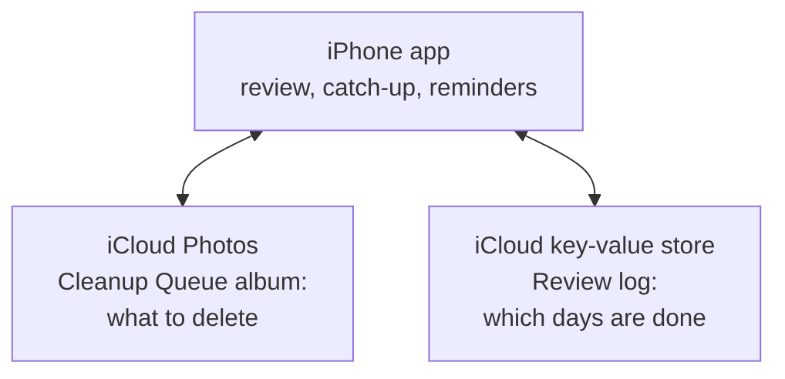

# my-first-iphone-app

An experienced engineer builds her first iPhone app, in public, for [Code Like A Little Old Lady](https://github.com/CodeLikeALittleOldLady).

The app is small on purpose. The journey is the point: the accounts, the tools, the confusing moments, and what it feels like to come to Swift and Xcode after years of building for the web.

---

## What the app does

Every day, the app shows you every photo you took **on this day, across all your years**. On November 21 you see November 21, 2026, November 21, 2025, and so on back to your oldest photo.

As you look, you flag the ones you no longer want: the twenty near-identical shots, the old screenshots, the blurry ones. Flagged photos are not deleted. They go into an album called **Cleanup Queue**.

Bursts and groups of near-identical photos taken close together are tagged as groups, so you can review them side by side and choose which ones to flag. A group is only a hint: nothing is flagged or deleted just because it belongs to one.

On December 31, you review the queue, save every flagged photo to a zip file, and only then clear it in one step. Nothing is destroyed without a copy.

A little each day, and one decision at the end of the year.

### Before and after

| Before | After |
|---|---|
| Cleanup is one huge job you face once a year, so you avoid it | Cleanup is a few minutes a day, made while you still remember the moment |
| Deleting happens in a hurry, one photo at a time | Deleting happens once, in December, with the whole year in view |
| Once it's gone, it's gone | Everything deleted is saved to a zip first, just in case |
| Miss a day and you lose track | Missed days wait for you in a catch-up list |
| Twenty shots of the same sunset, scattered through the day | Bursts and near-identical shots shown together, so you choose the keepers |

### Why build it when apps like this exist?

There are plenty of photo cleaner apps with an "On This Day" feature. This one exists because building it is the lesson. It also has one deliberate twist: **flag all year, keep a copy, delete once.** Most cleaners delete as you swipe.

---

## How it works

The app has no server and no account. It keeps state in two places Apple already syncs across your devices.



Each store has exactly one job:

- **The Cleanup Queue album** answers *what* to delete. It lives in your Photos library, so your flags survive even if the app is deleted.
- **The review log** answers *when* you looked. It is one entry per year, holding the set of month-days you have finished.

```
"reviewed-2027": ["01-01", "01-02", "01-04", ...]
```

### A day is reviewed once per year, not once forever

November 21 next year will include the photos you take this November 21, so it needs a fresh look. That is why the review log is keyed by year. Everything resets naturally on January 1.

---

## Design decisions

| Decision | Why |
|---|---|
| Flag into an album instead of deleting | Safe, reversible, and syncs on its own |
| Export before delete: originals saved to a zip, checked, then deleted | Like a shredding bag, things wait before they are destroyed. If the export fails, nothing is deleted |
| Delete once, at year end, with the system confirmation | One deliberate decision instead of hundreds of hasty ones. Deleted photos also stay in Recently Deleted for 30 days |
| In non-leap years, February 28 also shows February 29 photos | Otherwise leap-day photos would only come up every four years |
| Tag bursts and near-identical shots as groups, but never flag them automatically | Seeing them together makes choosing easy, and the decision stays yours. How groups are detected is still being investigated ([#43](../../issues/43)) |
| Days with no photos mark themselves reviewed | They should never clutter the catch-up list |
| Reminders are individual dated notifications | A repeating notification cannot skip the one day you already finished |
| iPhone first | A Mac version can reuse the same core logic later |

---

## Privacy

Your photos never leave your devices. The app has no server, no account, no analytics, and collects no data. The only things it writes are an album in your own Photos library, a small review log in your own iCloud, and, at year end, the zip file you choose to save. Finding groups of similar photos happens on your device.

---

## Follow along

The work is tracked in this repo, one milestone per episode of the series:

1. The idea, and the twenty apps that beat me to it
2. Designing before coding
3. Hello, Xcode
4. The core logic, test first
5. My first SwiftUI screen
6. Reminders and catch-up
7. Day one, January 1

Issue labels:

- `build`: work on the app
- `journey`: setup, accounts, tools, and confusing moments worth writing about
- `episode`: writing and publishing a post
- `side-quest`: optional deep dives into the code
- `later`: after January 1, such as sharing with friends and family through TestFlight

---

## Status

Designing. No code yet.

## License

[MIT](LICENSE)
