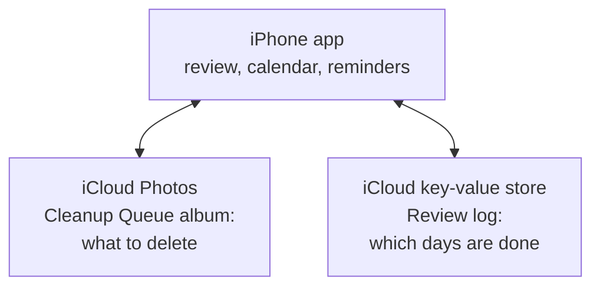

# my-first-iphone-app

An experienced engineer builds her first iPhone app, in public, for [Code Like A Little Old Lady](https://github.com/CodeLikeALittleOldLady).

The app is small on purpose. The journey is the point: the accounts, the tools, the confusing moments, and what it feels like to come to Swift and Xcode after years of building for the web.

---

## What the app does

Every day, the app shows you every photo you took **on this day, across all your years**. On November 21 you see November 21, 2026, November 21, 2025, and so on back to your oldest photo. Tap the date to open a calendar and visit any other month and day, including February 29.

As you look, you flag the ones you no longer want: the twenty near-identical shots, the old screenshots, the blurry ones. Flagged photos are not deleted. They go into an album called **Cleanup Queue**.

Bursts and groups of near-identical photos taken close together appear as one stacked tile. Open it to swipe through the photos, pick your keepers, and flag the rest. A group is only a hint: nothing is flagged or deleted just because it belongs to one.

At year end, a guided cleanup exports the flagged photos in smaller batches. Each batch is saved and checked before you are offered the choice to delete it, and you can stop and come back later. Nothing is destroyed without a verified copy.

A little each day, and one deliberate cleanup at the end of the year.

### Before and after

| Before | After |
|---|---|
| Cleanup is one huge job you face once a year, so you avoid it | Cleanup is a few minutes a day, made while you still remember the moment |
| Deleting happens in a hurry, one photo at a time | Deleting happens in one deliberate year-end cleanup, batch by batch, with the whole year in view |
| Once it's gone, it's gone | Every batch is saved and verified before you choose to delete it, just in case |
| Miss a day and you lose track | A calendar shows which days are reviewed, in progress, or waiting. No streaks, no guilt |
| Twenty shots of the same sunset, scattered through the day | Bursts and near-identical shots shown together, so you choose the keepers |

### Why build it when apps like this exist?

There are plenty of photo cleaner apps with an "On This Day" feature. This one exists because building it is the lesson. It also has one deliberate twist: **flag all year, keep a copy, then clean up deliberately.** Most cleaners delete as you swipe.

---

## How it works

The app has no server and no account. Its core state lives in two places Apple already syncs across your devices.



Each store has exactly one job:

- **The Cleanup Queue album** answers *what* to delete. It lives in your Photos library, so your flags survive even if the app is deleted.
- **The review log** answers *when* you looked. It is one entry per year, holding the set of month-days you have finished.

```
"reviewed-2027": ["01-01", "01-02", "01-04", ...]
```

### A day is reviewed once per year, not once forever

November 21 next year will include the photos you take this November 21, so it needs a fresh look. That is why the review log is keyed by year.

### More state, still being designed

The agreed design adds state beyond these two stores: where you left off, dates in progress, keeper choices within groups, and year-end batch progress. Where that state lives and how it syncs is still open ([#48](../../issues/48)), and so is how the yearly rollover works. Unfinished flags are never erased by a rollover.

---

## Design decisions

| Decision | Why |
|---|---|
| Flag into an album instead of deleting | Safe, reversible, and syncs on its own |
| Export before delete: originals saved, then verified | Like a shredding bag, things wait before they are destroyed. If an export fails, nothing in that batch is deleted. What "verified" means for each destination is still being investigated ([#47](../../issues/47)) |
| Export in smaller, resumable batches | A whole year at once is large and fragile. Batches can be saved, checked, and resumed |
| Delete each verified batch only by explicit choice, with the system confirmation | Exporting never deletes anything on its own. Deleted photos also stay in Recently Deleted for 30 days |
| February 29 is always its own date in the calendar | Leap-day photos stay reachable every year without being mixed into February 28 |
| Show bursts and near-identical shots as one stack, with keeper selection, but never flag them automatically | Swiping through a group makes choosing easy, and the decision stays yours. How groups are detected is still being investigated ([#43](../../issues/43)) |
| Days with no photos mark themselves reviewed, but only after a complete query | A failed load or limited photo access must never look like an empty day |
| "Done for today" only on today's date; "Day reviewed" on any other | The words should match the day you are actually looking at |
| A calendar instead of a catch-up list | You can visit any day, in any order, without a backlog counting against you |
| Reminders are individual dated notifications | A repeating notification cannot skip the one day you already finished |
| iPhone first | A Mac version can reuse the same core logic later |

---

## Privacy

The app has no server, no account, and no analytics, and it collects no data. Your photos only go where you send them: at year end, you choose where the exported batches are saved, such as a folder in Files or an attached drive. Finding groups of similar photos happens on your device.

---

## Design

The current design lives in [docs/design](docs/design). Start with the [design handoff](docs/design/DESIGN-HANDOFF.md), which records the agreed decisions and the questions that are still open. The six concept boards show the main screen, burst review, the calendar sheet, year-end batches, onboarding, and everyday states. The written decisions override any text or counts in the images.

Still open: the Settings screen, yearly rollover, new photos arriving on a reviewed date, whether cleanup is available outside December 31, limited photo access, and export verification. See [#48](../../issues/48) and [#47](../../issues/47).

---

## Follow along

The work is tracked in this repo, one milestone per episode of the series:

1. The idea, and the twenty apps that beat me to it
2. Designing before coding
3. Hello, Xcode
4. The core logic, test first
5. My first SwiftUI screen
6. Reminders
7. Day one, January 1

Issue labels:

- `build`: work on the app
- `journey`: setup, accounts, tools, and confusing moments worth writing about
- `episode`: writing and publishing a post
- `side-quest`: optional deep dives into the code
- `later`: after January 1, such as sharing with friends and family through TestFlight

---

## Status

Designing, with concept boards from Rowan. No code yet.

## License

[MIT](LICENSE)
