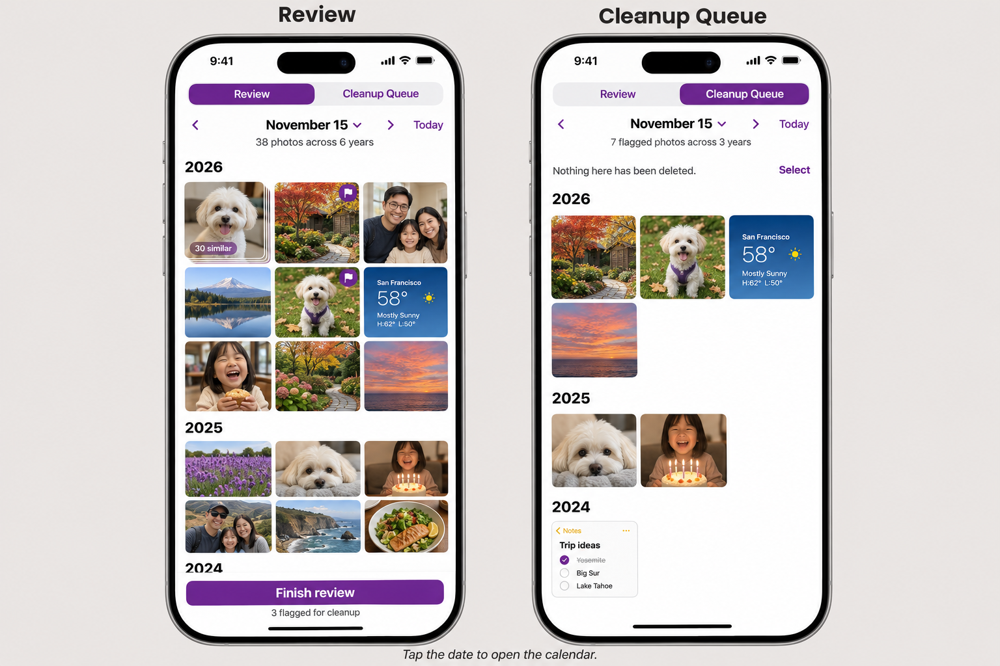
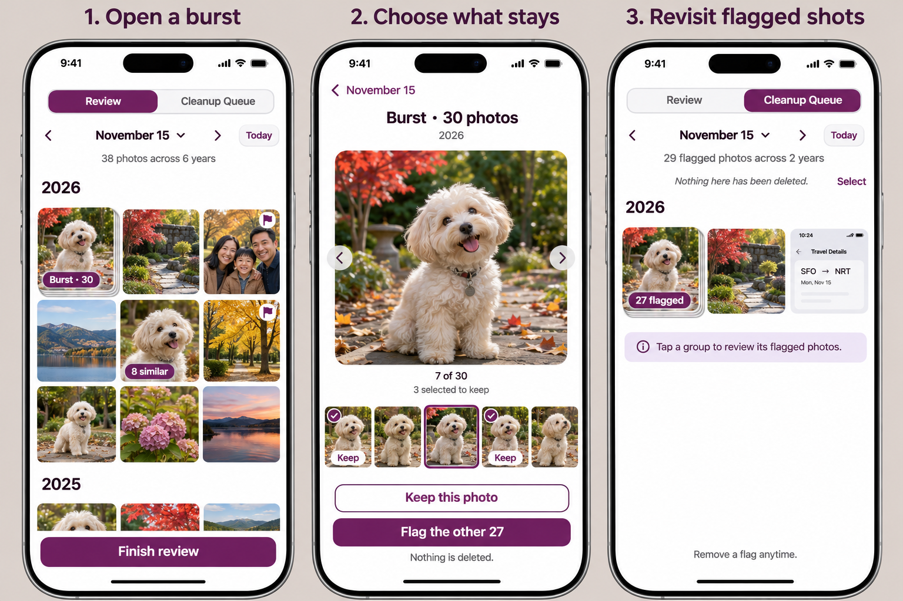
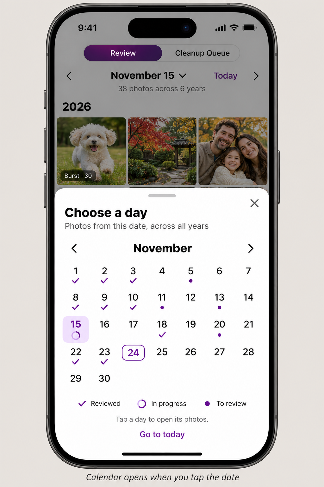
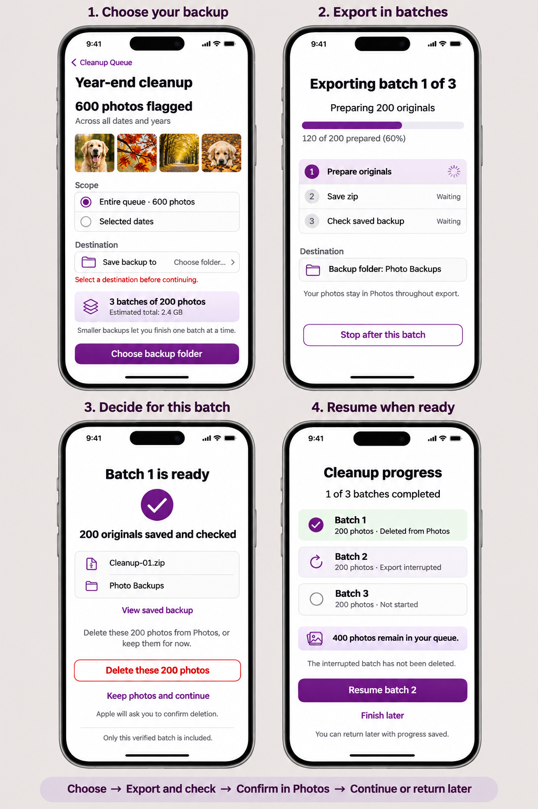
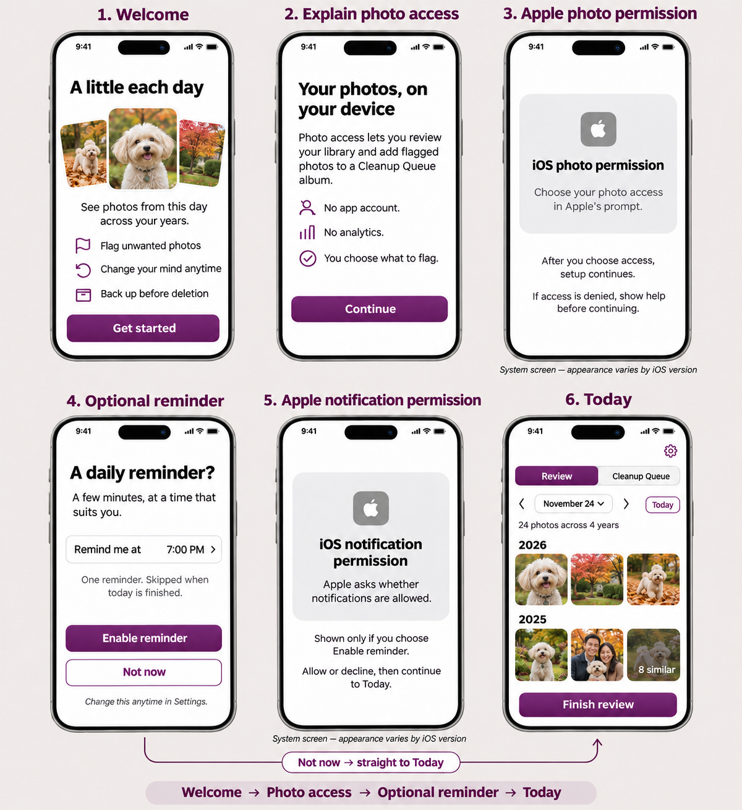
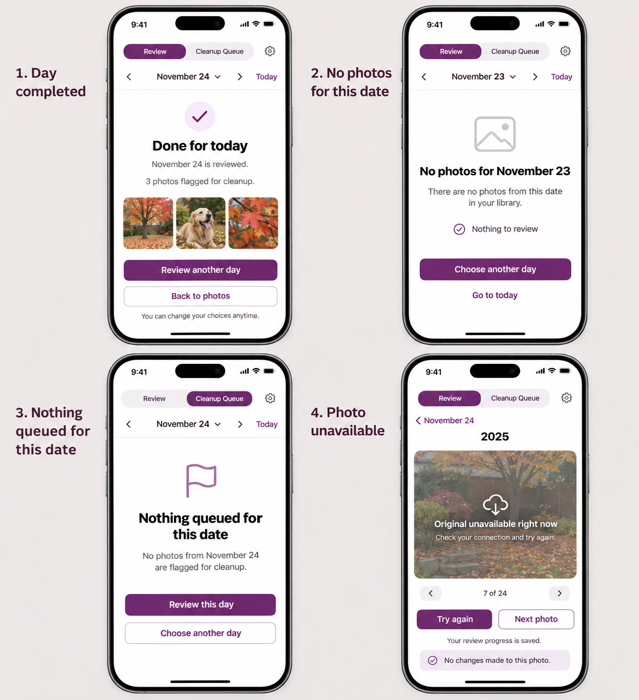

# ApplePhotoCleanup — design handoff

Date: 2026-11-24. Prepared for Alison and Lovelace. Design only; no application code or repository issues were changed.

## How to use this package

Copy `docs/design` into the application repository. Read this document before updating the README and backlog. Reconcile with existing issues rather than duplicating them. The supplied README references grouping issue #43; extend or link that issue where appropriate. Existing issues have not been inspected in this chat.

Written decisions below take precedence over illustrative text, counts, icons, and layout accidents in generated mockups. These are concept images, not production specifications. Earlier mockups with permanent calendars, separate Cleanup Queue tabs, or flagged-date navigation are superseded and intentionally omitted.

## Product and visual direction

A little each day, followed by deliberate year-end cleanup. Simple, clean, photo-first iPhone experience, white surfaces and restrained purple accents. No streaks or guilt about unfinished days. Flagging is reversible and never deletes a photo. No application account, server, or analytics. Similarity processing stays on device. Preserve the learning-project scope; no additional feature expansion is implied.

## Main screen and navigation — agreed

- One main screen, with Review / Cleanup Queue segmented control at the top. Preserve the selected date when switching modes.
- Compact date row: previous day, month/day heading with dropdown affordance, next day, Today shortcut. No bottom tabs.
- Photos use the remaining area, in a grid grouped by original photo year. Open an individual photo or group for focused review and easy swiping.
- Tapping the date opens a temporary dismissible calendar sheet. Selecting a day closes the sheet and opens that date. Month arrows navigate months; no year or weekday labels in this cross-year picker.
- A date always means the photo's capture month and day. November 15 shows November 15 photos across all years in Review, and only flagged November 15 photos across all years in Cleanup Queue. Do not add a calendar based on when flags were created.
- Every month/day is accessible, including future calendar dates and a permanent February 29. February 29 is Today only in leap years; do not fold its photos into February 28.
- On first use, open Today; all dates begin incomplete except confirmed dates with no photos, which complete automatically. There is no opt-in earlier-days backlog setting.
- Calendar Review markers: reviewed, in progress, waiting; distinguish empty dates. Queue mode displays remaining queued-photo counts for each capture month/day.

## Daily review and completion — agreed

- Review in any order. Individual flagging writes to the Cleanup Queue album; original stays in Photos. Offer unflagging and undo.
- Finish review is explicit. It does not require opening every photo or flagging anything.
- Leaving midway preserves place and keeps the date unfinished. Reopening a completed date allows changes.
- Completion wording MUST follow selected date: 'Done for today' only for today's date; otherwise 'Day reviewed'. Show the selected month/day beneath. Apply this to accessibility announcements as well as visible copy.
- No photos: say 'No photos for [month day]' and mark reviewed only after a successful complete query. Permission-limited or failed loading must not be reported as a truly empty full library.

## Bursts and similar-shot groups — agreed

- Identify actual camera bursts and likely near-identical photos taken close together. Detection approach and thresholds remain investigation work.
- One stacked tile per group: e.g. 'Burst · 30' for actual burst or '30 similar' for inferred grouping.
- Focused viewer: large swipeable photo, scrolling filmstrip following selection, position counter, individual flags and undo.
- Provide explicit keeper selection within the group, then 'Flag the other N'. Keeper choices alone do not flag anything. Never automatically flag or delete because of group membership.
- Keep-selection is a review control, not an instruction to alter Apple Photos Favorites.
- Preserve place on leaving and returning.
- Queue mode keeps flagged members grouped as e.g. '27 flagged'; open to swipe and remove flags. Support selecting multiple queued items to remove their flags.
- Side-by-side comparison is not required by the agreed design; easy swiping is sufficient.

## First launch and reminders — agreed

1. Brief introduction: photos across the years, reversible flags, backup before deletion.
2. Explain photo access; a SINGLE 'Continue' button opens Apple's permission dialog. Do not render the extra 'Opens Apple’s permission prompt' line or a second permission action.
3. Apple photo-access system prompt, then appropriate access result handling.
4. Optional daily reminder with time choice, Enable reminder and clear Not now.
5. Enable reminder invokes Apple's notification prompt. Not now skips it. Declining notifications still permits app use.
6. Open today's review.

Reminder behavior: one reminder at chosen time, skip today if finished, no repeated nudges, notification opens today's review. Easy change/disable through Settings. System-prompt panels in the board are annotations, not app screens or exact OS dialog designs. Use archive/file icon for backup, not a cloud-only implication.

## Cleanup Queue — agreed

Use the same compact navigation and capture-date calendar as Review. A selected-day empty state says 'Nothing queued for this date', not that the entire queue is empty. Opening a queued photo offers Remove from queue, which cancels the flag; the original never needed restoration. Allow bulk unflagging and undo. Grouping prevents large bursts overwhelming the grid.

## Year-end cleanup — agreed

A dedicated guided flow operates across the entire queue or selected dates, independent of the currently selected day. Entry location still needs Settings/menu design.

1. Summary: queue photo count, scope choice (entire queue or selected dates), estimated export size and chosen destination.
2. Export in smaller independently resumable batches. Save completed work; allow returning later. Exact batch sizes are NOT decided.
3. For each batch, prepare originals (including fetching unavailable originals), save the zip to chosen destination, verify the saved export.
4. Only a successfully saved and verified batch is eligible for deletion. Show its count, filename and destination, plus access to the saved copy.
5. Offer an explicit Delete these N photos choice or Keep photos and continue. Successful export never triggers deletion automatically. Deletion requires Apple's system confirmation.
6. Track results per batch, including interrupted, not started, saved/kept, and confirmed deletion. Do not mark deletion successful until the result is confirmed.
7. Failed, incomplete, or newly added photos remain untouched. A batch uses a fixed membership snapshot; subsequent flags wait for another export.

Destination options discussed: chosen Files location or attached external drive; one zip may suit small queues, but smaller batches are the agreed baseline. Size/space estimates and interruption handling must be validated before final claims. Saving to a cloud-backed Files folder does not by itself establish that remote upload has completed. Define what saved-and-verified means for each supported destination before enabling deletion. Include insufficient storage, unavailable destination, inaccessible originals, verification failure, cancellation, and partial deletion outcomes in acceptance criteria.

## Everyday states

- Completion: date-aware text, selected-day flagged count, return to photos or choose another day; no confetti or pressure.
- Empty photo date: nothing to review, choose another date or Today.
- Empty selected-day queue: review this day or choose another day.
- Unavailable original: clear retry/next options, preserve progress, no endless spinner. The mockup's connection message is illustrative; do not claim a network cause without evidence.

## Open design and feasibility work — not settled

- Settings screen: reminder time, permission status/recovery, and year-end cleanup entry. No Settings mockup yet.
- Individual photo viewer controls and zoom, undo duration/placement, bulk-selection interaction details.
- Limited/denied photo access recovery, especially queue/album capabilities under limited access. Do not promise unvalidated access behavior from explanatory mockups.
- Annual rollover: README currently resets review status per year. Specify that independently from remaining queue and batch-export records; do not erase undeleted flags. Exact rollover UX and newly arriving photos on already-reviewed dates need agreement.
- Precise export verification, temporary storage requirements, resumability and background/foreground constraints; supported original resources (e.g. Live Photos and burst members) and metadata preservation. These require engineering investigation, not claims inferred from concept art.
- Cleanup availability outside December 31 is not decided. Preserve the year-end intent; do not silently introduce a hard date lock or always-available deletion.
- Accessibility: dynamic text, contrast, touch targets, non-color status cues, VoiceOver labels/order and reduced motion need specification and review.

## README/backlog reconciliation

| Existing wording | Replace or clarify with |
|---|---|
| Catch-up list | On-demand month/day calendar sheet over the photo grid |
| February 28 includes leap-day photos | February 29 is permanently selectable as its own date |
| Side-by-side group review | Focused swipe viewer plus filmstrip and explicit keeper selection |
| One zip and clear in one step | Resumable independent batches; verified export then explicit batch deletion |
| Delete once | One deliberate year-end cleanup workflow, potentially multiple batch confirmations |
| Only album and review log as state | Account for saved position, group selections and export/batch progress; investigate storage/sync design |
| Photos never leave devices | Clarify user-directed export to chosen storage without introducing app-server collection |

Do not rewrite implementation architecture solely from a screenshot. Reconcile persistence and privacy wording with the behavior actually supported.

## Suggested backlog work packages

- [ ] Shared Review/Queue screen and persistent selected capture date.
- [ ] On-demand yearless calendar, permanent leap day, initial-state rules and date markers/counts.
- [ ] Focused photo review, flags, undo, progress and explicit completion with date-aware copy.
- [ ] Extend existing grouping issue #43: stacked tiles, swiping, keeper selection, bulk flag-rest and queued groups.
- [ ] Queue single/bulk unflagging and selected-day empty state.
- [ ] Onboarding and photo-permission result/recovery flows.
- [ ] Optional reminder setup, permission branch, scheduling and settings controls.
- [ ] Export feasibility investigation and destination verification contract before destructive implementation.
- [ ] Cleanup scope/destination, fixed batch manifests, export/check pipeline and resumable status.
- [ ] Explicit verified-batch deletion, system confirmation and accurate outcomes.
- [ ] Everyday/loading/failure states and accessibility review.
- [ ] Resolve Settings, annual rollover and new-photo-after-completion questions.

Use existing labels and episode structure. Add acceptance criteria from these decisions; retain unresolved questions as questions. No application code is requested by this handoff.

## Current screen inventory

### 01-review-and-queue.png

Compact main screen; supersedes permanent calendar and three-tab proposals.

### 02-burst-review.png

Burst/keeper/flagged-group flow. Sample totals are inconsistent; do not implement the numbers.

### 03-calendar-sheet.png

Temporary month/day picker. Same picker in Queue mode uses queued counts.

### 04-year-end-batches.png

Batch cleanup flow. Destination helper should be neutral, not red; batch sizes are examples.

### 05-onboarding.png

Final onboarding: Continue opens photo permission. System screens are explanatory placeholders, not UI to build.

### 06-everyday-states.png

Completion, empty date, empty selected-day queue, unavailable original. Apply date-aware completion wording below.

